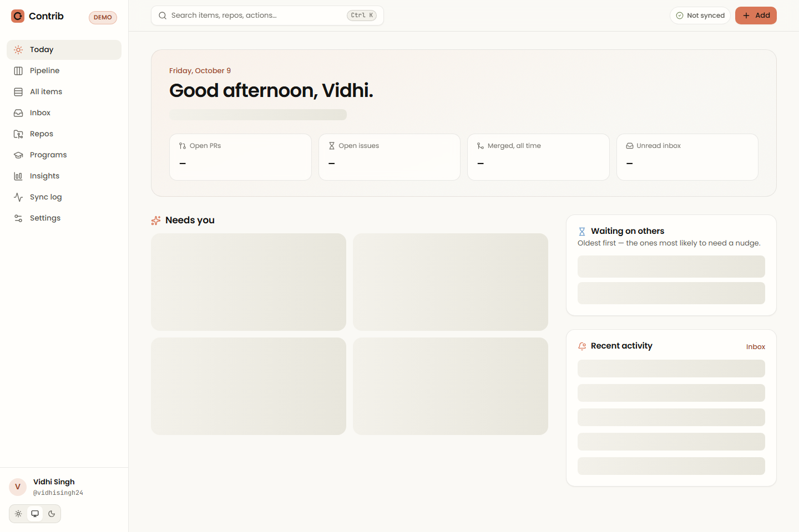
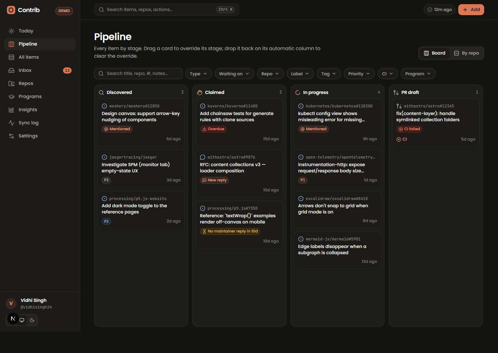

# Contrib

A calm, self-hosted dashboard that tracks every open-source issue, pull request, review, CI result, comment and notification you're involved in — and keeps itself up to date from GitHub. Open one page and know what needs you today, what's blocked on maintainers, and what changed since your last visit.

Single-user by design (allow-listed GitHub login). Notes, tags, priorities, reminders and planned items live in a manual layer that sync never overwrites.

| Today                                  | Pipeline (dark)                             |
| -------------------------------------- | ------------------------------------------- |
|  |  |

## Features

- **Today** — "Needs you" queue ranked by an attention score (failing CI, changes requested, maintainer replies, review requests, conflicts, due dates), waiting-on-others list, activity feed, "new since last visit".
- **Pipeline** — kanban by stage (Discovered → Claimed → In progress → PR draft → PR open → In review → Changes requested → Approved → Merged / Closed / Stale); drag to override; swimlanes by repo.
- **All items** — virtualized table with URL-persisted filters, sort, column chooser, saved views, bulk tag/priority/snooze/archive, CSV/JSON export.
- **Item detail** — CI checks (each linked), reviewers with review-state rings, unresolved threads, linked issue↔PR, merged timeline, next-action suggestion, notes/tags/due/reminder/snooze.
- **Repos, Programs (GSoC / LFX), Insights, Inbox, Sync log, Settings**, command palette (`Ctrl/⌘ K`), keyboard shortcuts (`?`).
- Optional pings via Email (Resend), Telegram or ntfy for high-priority events, quiet hours and a morning digest.

## Quick start (demo data, 5 commands)

```bash
git clone <this repo> contrib && cd contrib
cp .env.example .env            # leave OAuth vars empty → demo mode
docker compose up -d --build    # postgres + web + worker
open http://localhost:3000      # Windows: start http://localhost:3000
docker compose logs -f web      # optional
```

### Local development

```bash
pnpm install
docker compose up -d postgres            # Postgres on :5433
cp .env.example .env && cp .env apps/web/.env.local
pnpm dev                                 # web on :3000 + worker
pnpm test && pnpm typecheck && pnpm lint # core unit + integration (PGlite + msw)
pnpm e2e                                 # Playwright smoke (builds/starts in demo mode)
```

## Connect your GitHub

1. Create an OAuth app at **GitHub → Settings → Developer settings → OAuth Apps → New OAuth App**
   - Homepage URL: `http://localhost:3000` (or your domain)
   - Authorization callback URL: `http://localhost:3000/api/auth/callback/github` (or `https://<domain>/api/auth/callback/github`)
2. Put the Client ID / secret in `.env`, plus:
   ```bash
   AUTH_SECRET=$(openssl rand -base64 32)
   TOKEN_ENCRYPTION_KEY=$(openssl rand -base64 32)
   ALLOWED_GITHUB_LOGIN=vidhisingh24
   ```
3. Restart. Sign in — demo data is wiped, the token is stored AES-256-GCM encrypted, and the worker starts a full sync.

Scopes requested: `read:user notifications public_repo` (`repo` instead of `public_repo` with `GITHUB_PRIVATE_REPOS=true`). The token never reaches the browser.

## Environment variables

| Variable                                                 | Required         | Purpose                                                                  |
| -------------------------------------------------------- | ---------------- | ------------------------------------------------------------------------ |
| `DATABASE_URL`                                           | yes (web/worker) | Postgres connection string                                               |
| `APP_URL`                                                | prod             | Public URL (callbacks, links in pings)                                   |
| `AUTH_GITHUB_ID` / `AUTH_GITHUB_SECRET`                  | for live mode    | GitHub OAuth app; absent → demo mode                                     |
| `AUTH_SECRET`                                            | with OAuth       | Session signing secret                                                   |
| `TOKEN_ENCRYPTION_KEY`                                   | with OAuth       | 32-byte key (base64/hex) for token encryption                            |
| `ALLOWED_GITHUB_LOGIN`                                   | —                | Only this login can sign in (default `vidhisingh24`)                     |
| `GITHUB_PRIVATE_REPOS`                                   | —                | Request `repo` scope                                                     |
| `GITHUB_TOKEN`                                           | —                | PAT fallback for headless worker                                         |
| `DEMO_MODE`                                              | —                | Force demo mode (showcase deployments)                                   |
| `WEBHOOKS_ENABLED` / `GITHUB_WEBHOOK_SECRET`             | —                | Optional HMAC-verified webhook at `/api/webhooks/github` (repos you own) |
| `RESEND_API_KEY`, `NOTIFY_EMAIL_TO`, `NOTIFY_EMAIL_FROM` | —                | Email pings                                                              |
| `TELEGRAM_BOT_TOKEN`, `TELEGRAM_CHAT_ID`                 | —                | Telegram pings                                                           |
| `NTFY_URL`, `NTFY_TOKEN`                                 | —                | ntfy pings                                                               |
| `LOG_LEVEL`                                              | —                | pino level                                                               |

Every variable is documented in [.env.example](.env.example) and validated at startup (the app fails fast with a readable list).

## Deploy as a website (free: Vercel + Supabase/Neon + GitHub Actions)

1. **Supabase** (https://supabase.com) → new project → **Connect** → copy the **Session pooler** URI (port 5432) and fill in your DB password. (Neon works too: copy its connection string.)
2. Push this repo to GitHub.
3. **Vercel** (https://vercel.com) → Add New Project → import the repo → **Root Directory: `apps/web`** → add env vars:
   `DATABASE_URL`, `AUTH_GITHUB_ID`, `AUTH_GITHUB_SECRET`, `AUTH_SECRET`, `TOKEN_ENCRYPTION_KEY`, `CRON_SECRET`, `ALLOWED_GITHUB_LOGIN=vidhisingh24`, `APP_URL=https://<app>.vercel.app` → Deploy.
4. GitHub OAuth app → set callback URL to `https://<app>.vercel.app/api/auth/callback/github`.
5. GitHub repo → Settings → Secrets and variables → Actions → add `APP_URL` and `CRON_SECRET` (same value). The included `Scheduled sync` workflow then refreshes everything every 10 minutes.

On Vercel there is no separate worker: sync runs inside `/api/cron/sync` (and after "Sync now"), detected automatically (`SYNC_MODE=inline`).

## Deploy (Docker / VPS)

- **Any VPS:** `docker compose up -d --build` behind a TLS proxy (Caddy/nginx). Set `APP_URL` to the public URL.
- **Fly.io:** see [fly.toml](fly.toml): `fly postgres create`, attach, `fly secrets set …`, `fly deploy`. Run the worker as a second app (`build-target = "worker"`).
- Health: `GET /api/health` → DB status, last-sync age, API quota.

## FAQ

**Why polling, not webhooks?** You contribute to repos you don't own, so you can't install webhooks there. Contrib uses GraphQL search for discovery, batched GraphQL for hydration, and conditional `GET /notifications` (`If-Modified-Since`, `X-Poll-Interval`; 304s are free) as a cheap "something changed" signal that triggers targeted refreshes. Webhooks are supported only as an optional accelerator for repos you own.

**Will sync overwrite my notes?** No. Manual data lives in `user_meta` / `repo_meta`, which sync code never writes.

**Rate limits?** Every GraphQL response's `rateLimit { cost remaining resetAt }` is recorded; non-essential work stops below a configurable floor, secondary limits honour `Retry-After`, and the remaining quota is shown in the UI.

More: [docs/ARCHITECTURE.md](docs/ARCHITECTURE.md) · [docs/DESIGN.md](docs/DESIGN.md) · [docs/DECISIONS.md](docs/DECISIONS.md)
